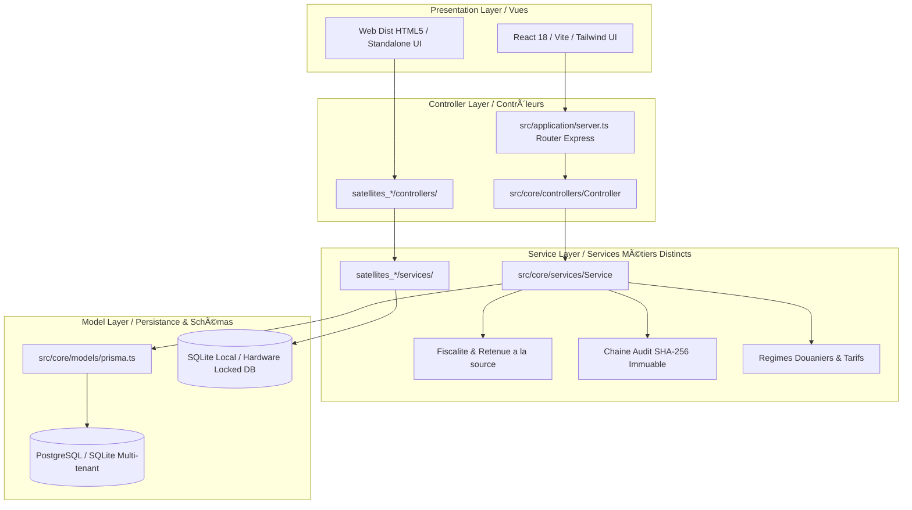

# Architecture MVC et Services Distincts - SAFE ERP Suite

Cette documentation décrit la restructuration globale de la suite **SAFE ERP** et de **l'ensemble des logiciels satellites (métiers et sectoriels)** selon le patron **Modèle - Vue - Contrôleur (MVC)** appuyé par des **Services Métiers Distincts**.

---

## 1. Schéma d'Architecture Global

---

## 2. Découpage Organisationnel

### 2.1 CÅ“ur de l'ERP (`src/core/`)
- **Modèles (`src/core/models/`)** :
  - Centralisation du client Prisma via `src/core/models/prisma.ts`.
  - Abstraction de persistance multi-base (PostgreSQL pour la production, SQLite pour le mode autonome/embarqué).
- **Contrôleurs (`src/core/controllers/`)** :
  - 27 contrôleurs modulaires (`admin`, `finance`, `sales`, `purchases`, `hr`, `materials`, `production`, etc.).
  - Validation des requêtes et isolation du contexte utilisateur/entité (`resolveEntityScope`).
- **Services (`src/core/services/`)** :
  - Logique métier pure isolée de toute dépendance HTTP.
  - Calculs fiscaux tunisiens (TVA 19/13/7%, retenue à la source, timbres fiscaux, règlements).
  - Piste d'audit cryptographique et chaînage SHA-256.

### 2.2 Logiciels Satellites Métiers (`satellites_metiers/`)
Découpés en `models/`, `services/`, `controllers/` :
1. `SAFE_Comptabilite_Fiscalite` : SCE, Grand Livre, Balance 8 colonnes, Déclarations G50.
2. `SAFE_Facturation` : Devis, Factures, Avoirs, Facturation électronique tunisienne.
3. `SAFE_Gestion_des_Stocks` : Multi-dépôts, valorisation FIFO/PUMP, inventaires.
4. `SAFE_Gestion_RH` : Suivi collaborateurs, congés, carrières.
5. `SAFE_Immobilisations` : Amortissements linéaires/dégressifs, cessions.
6. `SAFE_Paie` : Bulletins de paie conformes barème IRPP/CNSS 2026.
7. `SAFE_Production_GPAO` : Ordres de fabrication, nomenclatures, gammes.

### 2.3 Progiciels Satellites Sectoriels (`satellites_sectoriels/`)
Organisés en architectures MVC FastAPI / Python autonomes (`models/`, `services/`, `controllers/`) :
1. `00_SAFE_CRM_Editeur_Licences` : Gestion des licences et parc clients.
2. `01_SAFE_Negoce_Distribution` : Port 8001 - Ventes B2B, logistique de distribution.
3. `02_SAFE_Services_Cabinets` : Port 8002 - Facturation au temps passé, gestion de dossiers.
4. `03_SAFE_Industrie_Production` : Port 8003 - GPAO avancée, coût de revient standard/réel.
5. `04_SAFE_Restauration_POS` : Port 8004 - Caisse tactile, gestion des tables et stocks frais.
6. `05_SAFE_Transport_Logistique` : Port 8005 - Flotte, feuilles de route, entreposage WMS.

---

## 3. Conformité et Robustesse
- **Vérification TypeScript** : Compilation complète réussie sans erreurs via `npx tsc --noEmit`.
- **Rétrocompatibilité** : Préservation des points de montage et routes d'API existantes pour les interfaces React.
- **Sécurité** : Validation d'intégrité HMAC-SHA256 et verrouillage matériel Hardware-ID sur les exécutables autonomes.
